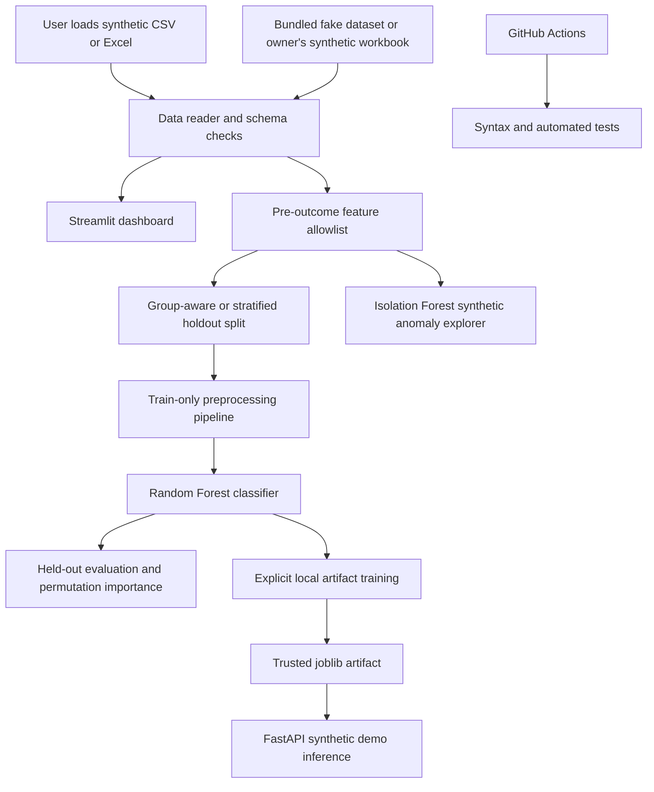

# Reference architecture — FDE interview notes

## Customer-oriented engineering choices

- **Problem framing:** Data-science demonstration with no clinical risk claims.
- **Data contract:** CSV or XLSX (default workbook `Dataset` sheet; first-sheet fallback for uploads). File and row limits.
- **Training consistency:** Scikit-learn `Pipeline` fits preprocessing only on the training partition.
- **Leakage controls:** Excludes identifiers, post-outcome survival, raw dates, demographic fields and arbitrary unknown columns.
- **Evaluation:** Held-out metrics + majority-class baseline; group-aware split when participant IDs repeat.
- **Serving:** FastAPI uses explicitly generated local model artifacts and requires complete feature dictionaries.
- **Release process:** Isolated upgrade branch, unit tests + syntax CI, staging Streamlit app, manual promotion.
- **Security:** No PHI; local-only unauthenticated API; no uploaded-file persistence; pickle artifacts must remain trusted.
- **Observability roadmap:** Error rates, latency, validation failures, model drift, calibration and review of logging policy.

## Why this is not clinical software

Synthetic data, simplistic feature selection, no clinical oversight or external verification, no medical-device regulatory review, no authenticated PHI-safe infrastructure, and no protection against model drift. Model metrics are **not** diagnostic performance estimates.
